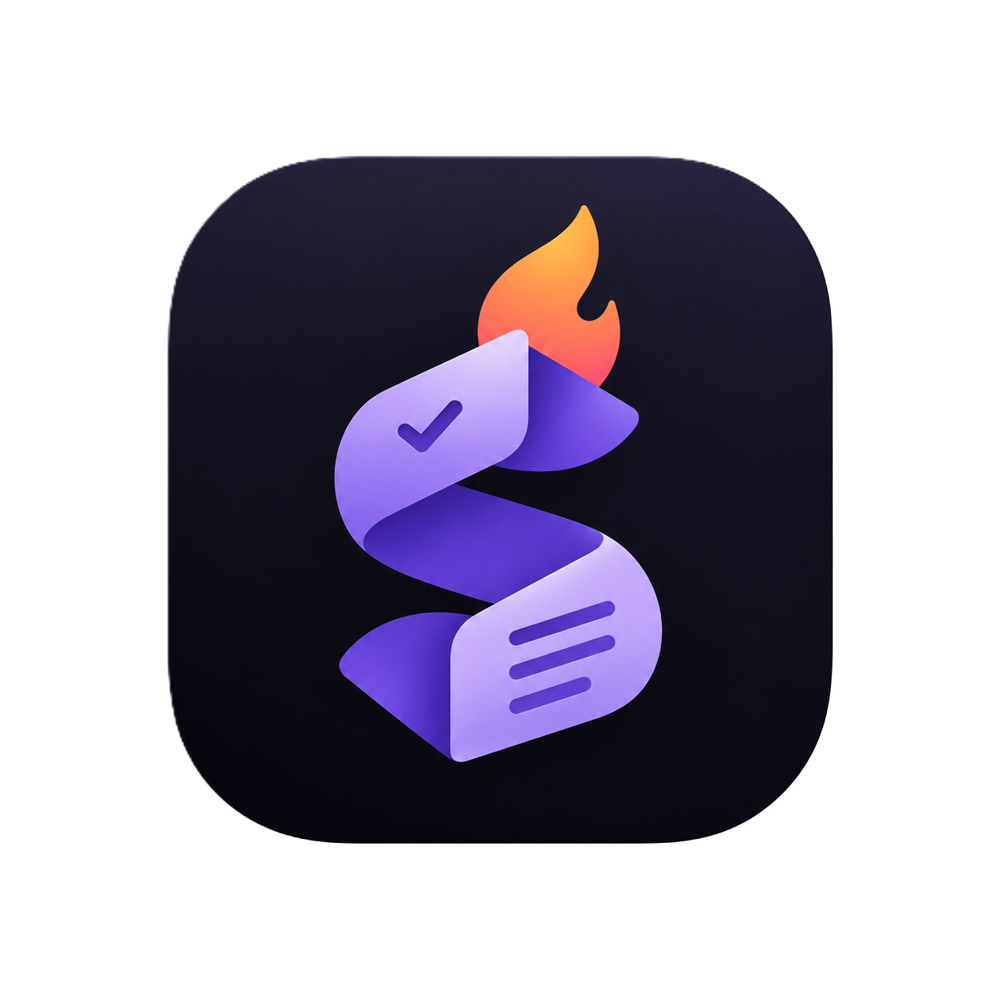

  

  <h1>Streakin</h1>

  
A private, calm, beautiful place to build habits and think in notes.

  
  
  
  

---

## What is Streakin?

Streakin is an **offline-first, privacy-first** personal productivity app built around two pillars: a **habit tracker** and a **notetaker**. Everything stays on your device, encrypted at rest. No account, no cloud, no analytics — ever.

The to-do list, calendar, and dashboard exist to serve those two pillars, not the other way around.

---

## Features

### Habits
- Daily habit tracking with flexible schedules (every day, weekdays, or custom days)
- One-tap check-in with streak tracking and best-streak history
- **Lock-in streaks** — the moment all habits for the day are done, the day locks in
- Rest tokens — take planned rest days without breaking your streak (configurable weekly cap)
- Weekly and monthly views with completion heatmaps
- Milestone celebrations at 7, 14, 30, 60, 90, 180, 365 days

### Notetaker *(coming in v0.2)*
- Block-based rich text editor with tables, checklists, code blocks
- `[[Wiki links]]` between notes — build a personal knowledge graph
- Folders, tags, and note templates
- Semantic search powered by an on-device MiniLM model
- Attachment support: images, PDFs, `.docx`, `.pptx`
- Note vaults with independent lock/encryption

### To-do *(coming in v0.3)*
- Tasks with due dates, priorities, and reminders
- Tasks appear on the calendar alongside habit events

### Dashboard
- Today ring showing daily habit completion
- Lock-in streak counter
- Consistency chart (7d / 30d / 90d)
- At-risk habits — habits not yet done today
- Quick actions

### Calendar *(coming in v0.2)*
- Month view showing habits, tasks, and note date mentions in one place
- The calendar is a read-only projection — it never owns data

### Privacy & Security
- All data encrypted with AES-256-GCM via SQLCipher
- Password-based unlock using Argon2id key derivation
- Recovery key generated at setup — the only way back in if you forget your password
- Auto-lock on app background with configurable timeout
- Zero network permissions in release builds

### Zen Mode *(coming in v0.4)*
- Distraction-free writing and reflection space

---

## Platforms

| Platform | Status |
|---|---|
| Android | ✅ Active development |
| Windows | ✅ Active development |
| Linux | 🔜 Phase 2 |
| iOS | 🔜 Phase 8 |
| macOS | 🔜 Phase 8 |

---

## Versions

| Version | Status | Highlights |
|---|---|---|
| **0.1.0-alpha** | 🚧 In progress | Habits, dashboard, calendar, lock/unlock, encrypted local DB |
| 0.2.0 | Planned | Notetaker core, wiki links, attachments |
| 0.3.0 | Planned | To-do list, calendar integration |
| 0.4.0 | Planned | Zen mode, encrypted export/import |
| 0.5.0 | Planned | Desktop tray, background reminders |
| 1.0.0 | Planned | Full feature set, iOS + macOS |

---

## Philosophy

> Fewer, finished features. Every animation has a purpose. Private by construction, not by policy.

Streakin is built on the belief that the best productivity tool is one that stays out of your way, respects your privacy unconditionally, and makes the small daily wins feel meaningful.

---

  Built by <a href="https://incantum.in">Incantum</a> · No telemetry · No cloud · Your data stays yours

